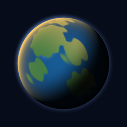

# Emergenz

Gott-Simulation für Android: ein Planet, auf dem Klima, Pflanzen und Lebewesen nur aus Regeln entstehen.
Nichts ist vorgeschrieben. Du kannst zusehen oder eingreifen: Sonne, CO2, Meteore, Regen, Dürre, neues Leben.

## Download

Die neueste APK gibt es unter [Releases](../../releases/latest). Auf dem Handy öffnen und installieren.
Android warnt dabei vor einer unbekannten App, weil sie nicht aus dem Play Store kommt.
Neue Versionen einfach über die alte installieren, die gespeicherte Welt bleibt.

## Was passiert in der Welt

- **Klima:** Einstrahlung nach Breitengrad, Jahreszeit und Achsneigung, Energiebilanz mit Wärmetransport,
  Ozeane als Wärmespeicher, Eis wirft Licht zurück, CO2 hält Wärme. Regen folgt Windgürteln und Gebirgen.
- **Pflanzen:** wachsen so viel, wie Temperatur und Regen erlauben (Miami-Modell), Algen nach Licht und Nährstoffen.
- **Leben:** Jeder Punkt ist eine Gruppe von Lebewesen mit Erbgut aus neun Zahlen. Bei jeder Teilung mutiert es.
  Was überlebt, entscheidet die Umwelt. So entstehen Mehrzeller, Landtiere, Räuber und neue Arten.
- **Chronik:** Die Welt schreibt ihr eigenes Geschichtsbuch.

Mehr zur Idee und zu möglichen nächsten Schritten: [docs/KONZEPT.md](docs/KONZEPT.md).

## Selber bauen

Web-App (HTML, CSS, JavaScript ohne Build-Schritt) in [Capacitor](https://capacitorjs.com).
Jeder Push auf `main` testet die Simulation, testet die Oberfläche im Browser, baut die APK, startet sie im
Android-Emulator und veröffentlicht sie als Release. Dafür braucht der Build das Secret `KEYSTORE_PASSWORD`.

- Simulation testen: `node --test tests/sim.test.mjs`
- Im Browser ansehen: `python3 -m http.server 8080 --directory www`
- Karten als Bilder: `node tools/render-map.mjs 12345 500`
